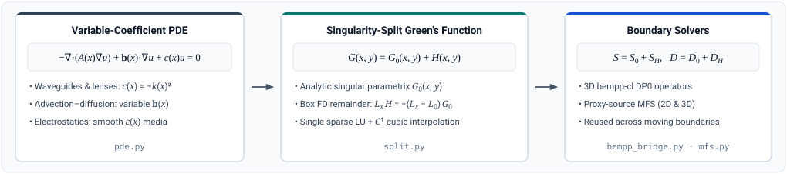
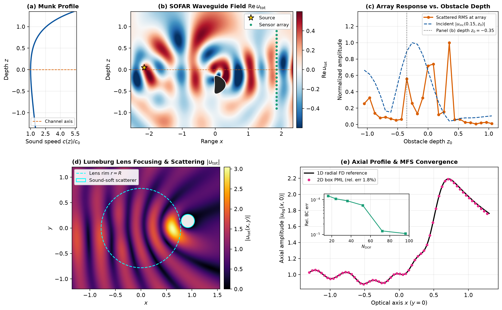
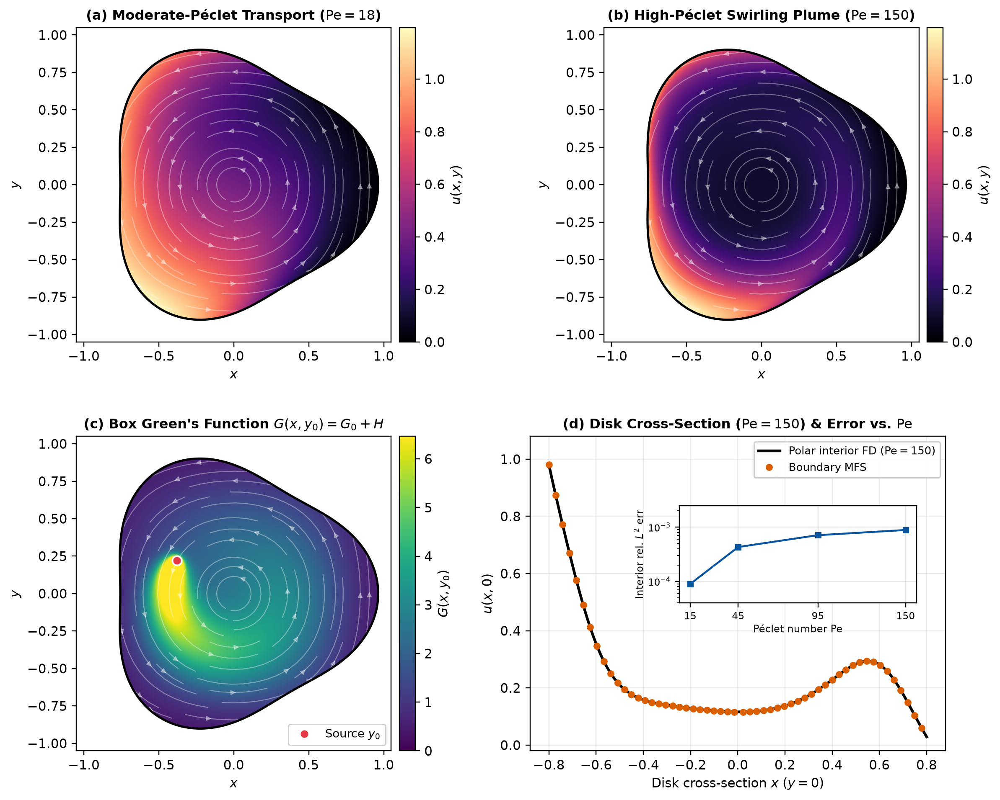
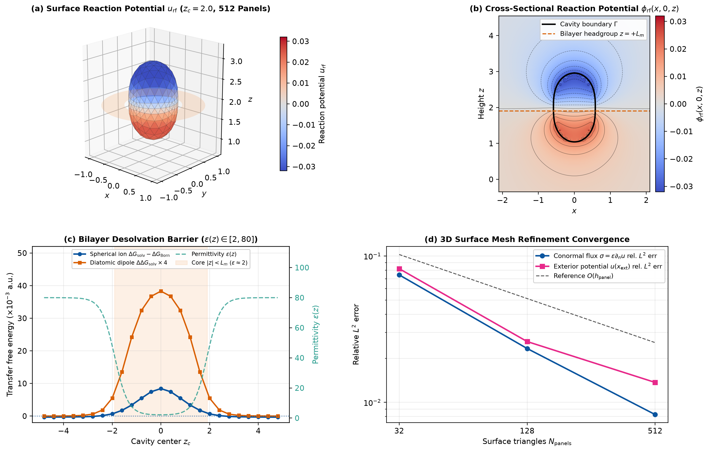

# numgreen

`numgreen` computes numerical Green's functions for 2D and 3D linear elliptic PDEs with smooth spatially varying coefficients, for use in boundary integral equations (`bempp-cl`, Nyström quadrature) and the Method of Fundamental Solutions (MFS).

<p align="center">
  
</p>

## Formulation and scope

For a second-order elliptic operator on a bounded or exterior domain $\Omega \subset \mathbb{R}^d$ ($d = 2, 3$),

$$L u(x) = -\nabla \cdot (A(x)\nabla u(x)) + b(x)\cdot\nabla u(x) + c(x) u(x) = 0,$$

boundary integral and proxy-source solvers need a kernel satisfying $L_x G(x, y) = \delta(x - y)$ while preserving the exact near-field singularity required by jump relations and singular quadrature. `numgreen` splits $G$ on an enclosing Cartesian box $B$ into an analytical parametrix $G_0$ (`pde.py`) and a smooth remainder $H$ (`split.py`):

$$G(x, y) = G_0(x, y) + H(x, y), \qquad L_x H(\cdot, y) = -(L_x - L_0) G_0(\cdot, y).$$

- **Isotropic diffusion / permittivity and Helmholtz ($A = a I$, $b = 0$):** Liouville scaling $G_0(x, y) = g_{k_0}(|x - y|) / \sqrt{a(x)a(y)}$ with $(-\Delta - k_0^2)g_{k_0} = \delta$ cancels both $\delta(x - y)$ and the $O(|x - y|^{1-d})$ gradient term $\nabla a \cdot \nabla G_0$.
- **Advection–diffusion ($b \neq 0$):** Frozen-drift kernel $G_0(x, y) \propto e^{\beta_y \cdot (x - y)} K_0(\mu_y |x - y|)$ in 2D (Yukawa in 3D) with $\beta_y = b(y)/(2a(y))$, evaluated via `scipy.special.kve` for stability at high Péclet numbers.
- **Anisotropic diffusion ($A(x)$ SPD):** Frozen-metric fundamental solution centered at $A(y)$.

`SplitGreen` discretizes $L_x$ on $B$ by second-order finite differences (Dirichlet, Robin, uniaxial PML, or 3D radial monopole outer BCs), caches one `scipy.sparse.linalg.splu` factorization, solves for $H$ from a sub-grid regularized right-hand side ($r_{\mathrm{reg}} = 0.35 h$), and interpolates $(H, \nabla_x H, \nabla_y H)$ via $C^1$ Catmull–Rom splines (`tabulate_sources` precomputes $H$ on a coarse source grid for moving boundaries). Because $H$ lives on $B$, this is a hybrid grid-assisted method: accuracy follows the $O(h^2)$ box resolution for smooth positive $C^2$ media, and direct 3D sparse LU targets smooth backgrounds rather than high-frequency 3D acoustics.

## Quickstart

```bash
uv venv .venv && uv pip install --python .venv/bin/python -e ".[dev]"
```

```python
import numpy as np
from numgreen import PDE, SplitGreen, solve_mfs

vel = lambda X: np.column_stack([-np.cos(1.35 * X[:, 0]) * np.sin(1.35 * X[:, 1]),
                                 +np.sin(1.35 * X[:, 0]) * np.cos(1.35 * X[:, 1])])
pde = PDE.advection_diffusion(diffusivity=0.012, velocity=vel, reaction=0.15, dim=2)
green = SplitGreen(pde, bounds=[(-1.4, 1.4), (-1.4, 1.4)], shape=161, bc="dirichlet")

theta = np.linspace(0, 2 * np.pi, 128, endpoint=False)
normals = np.column_stack([np.cos(theta), np.sin(theta)])
sol = solve_mfs(pde, green, 0.8 * normals, 0.5 * (1.0 - np.tanh(1.76 * np.cos(theta))), normals=normals, offset=0.2)
```

For 3D surface problems, `BemppOperators(pde, green, grid)` wraps `bempp-cl` piecewise-constant (`DP0`) operators as $S = S_0 + S_H$ and $D = D_0 + D_H$ under rigid translations `shift` (see `examples/03_bempp_dielectric_membrane.py`).

## Examples

### 1. Waveguide and graded-index scattering (`examples/01_sofar_grin_scattering.py`)

Barnett, Nelson & Mahoney (2015) showed the effectiveness of boundary integral equations for obstacle scattering in horizontally stratified waveguides, achieving high-order accuracy up to high frequencies for $(\Delta + E + x_2)u = 0$ via steepest-descent quadrature of the exact Airy Green's function. `numgreen` targets the complementary low-to-moderate frequency setting where $c(x)$ has no closed-form or separable Green's function, trading asymptotic high-frequency accuracy for general smooth media on a PML box. One factorization resolves Munk's (1974) deep-ocean SOFAR channel across a 25-depth obstacle sweep (72 MFS unknowns) and focusing/scattering in a smoothed Luneburg lens $n(r) = \sqrt{2 - (r/R)^2}$ (1.8% axial $L^2$ error vs. a 1D radial reference).

<p align="center">
  
</p>

### 2. Rotational advection–diffusion (`examples/02_taylor_green_peclet.py`)

Dual Reciprocity and radial-integration BEM methods (Wrobel & DeFigueiredo 1991; Rap, Elliott et al. 2007; Guiggiani 2020) solve variable-velocity convection–diffusion $-D\Delta u + v(x)\cdot\nabla u + c u = 0$ directly on $\Omega$ using interior basis expansions, requiring no auxiliary background grid. When factoring an enclosing box once is practical, pairing the frozen-drift parametrix $G_0$ with the box remainder $H$ lets boundary solvers work with boundary unknowns alone in rotational flows. In a cellular Taylor–Green vortex, 144 MFS unknowns resolve the spiral plume at $\mathrm{Pe} = 150$ and match a polar finite-difference solver on a disk to $8.8 \times 10^{-4}$ relative interior $L^2$ error across $\mathrm{Pe} \in [15, 150]$.

<p align="center">
  
</p>

### 3. 3D solvation across a smooth dielectric bilayer (`examples/03_bempp_dielectric_membrane.py`)

Cheng (1984) introduced the Liouville transformation from $-\nabla\cdot(\varepsilon\nabla u) = 0$ to $(-\Delta + q)(\sqrt{\varepsilon} u) = 0$ with $q = \Delta\sqrt{\varepsilon}/\sqrt{\varepsilon}$, yielding closed-form BEM kernels when $q$ is constant; the same reduction underlies grid-free Monte Carlo estimators for general smooth media (Sawhney et al. 2022, 2023), alongside analytical slab models (Parsegian 1969), image-charge FMMs for canonical interfaces (Cai, Deng & Jacobs 2007), and 3D continuum solvation solvers (Fisicaro et al. 2016). Building on Cheng's formulation when $q(z)$ varies across a smooth lipid bilayer $\varepsilon(z) \in [2, 80]$, `BemppOperators` combines `bempp-cl` Laplace `DP0` matrices on a reference molecular mesh with tabulated remainder matrices $(S_H, D_H)$. Translating a 512-panel ion and polar diatomic cavity across 25 heights recovers the bulk Born limit, Parsegian's midplane barrier, and $O(h_{\mathrm{panel}})$ convergence.

<p align="center">
  
</p>

## Layout and tests

- `src/numgreen/pde.py`: 2D/3D PDE specification and leading parametrix $G_0$
- `src/numgreen/split.py`: Cartesian-box finite-difference remainder $H$, sparse LU cache, cubic interpolation
- `src/numgreen/bempp_bridge.py`: 3D `bempp-cl` `DP0` surface operator wrapper ($S = S_0 + S_H$, $D = D_0 + D_H$)
- `src/numgreen/mfs.py`: Proxy-source Method of Fundamental Solutions solver

```bash
.venv/bin/pytest -v
.venv/bin/python examples/01_sofar_grin_scattering.py
.venv/bin/python examples/02_taylor_green_peclet.py
.venv/bin/python examples/03_bempp_dielectric_membrane.py
```

## References

- A. H. Barnett, B. J. Nelson & J. M. Mahoney, *High-order boundary integral equation solution of high frequency wave scattering from obstacles in an unbounded linearly stratified medium*, J. Comput. Phys. **297**, 407–426 (2015).
- W. H. Munk, *Sound channel in an exponentially stratified ocean, with application to SOFAR*, J. Acoust. Soc. Am. **55**(2), 220–226 (1974).
- L. C. Wrobel & D. B. DeFigueiredo, *A dual reciprocity boundary element formulation for convection-diffusion problems with variable velocity fields*, Eng. Anal. Bound. Elem. **8**(6), 312–319 (1991).
- A. Rap, L. Elliott, D. B. Ingham, D. Lesnic & X. Wen, *The inverse source problem for the variable coefficients convection-diffusion equation*, Inverse Probl. Sci. Eng. **15**(5), 413–440 (2007).
- M. Guiggiani, *Lubrication problems solved by the boundary element method*, Eng. Anal. Bound. Elem. **119**, 183–188 (2020).
- A. H.-D. Cheng, *Darcy's flow with variable permeability: A boundary integral solution*, Water Resour. Res. **20**(7), 980–984 (1984).
- R. Sawhney, D. Seyb, W. Jarosz & K. Crane, *Grid-Free Monte Carlo for PDEs with Spatially Varying Coefficients*, ACM Trans. Graph. **41**(4), Art. 53 (2022); R. Sawhney, B. Miller, I. Gkioulekas & K. Crane, *Walk on Stars: A Grid-Free Monte Carlo Method for PDEs with Neumann Boundary Conditions*, ACM Trans. Graph. **42**(4), Art. 79 (2023).
- V. A. Parsegian, *Energy of an ion crossing a low dielectric membrane: solutions to four relevant electrostatic problems*, Nature **221**, 844–846 (1969); W. Cai, S. Z. Deng & D. Jacobs, *Extending the fast multipole method to charges inside or outside a dielectric sphere*, J. Comput. Phys. **223**(2), 846–864 (2007); G. Fisicaro, L. Genovese, O. Andreussi, N. Marzari & S. Goedecker, *A generalized Poisson and Poisson-Boltzmann solver for electrostatic environments*, J. Chem. Phys. **144**(1), 014103 (2016).

## License

Released under the [MIT License](LICENSE).
